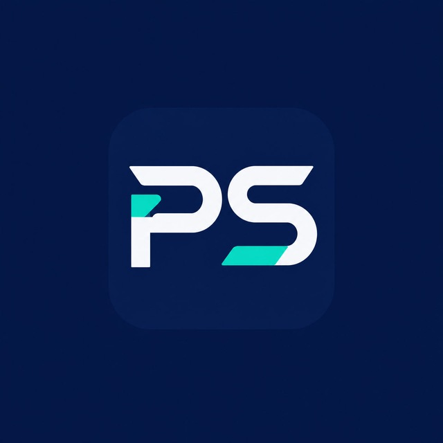

<p align="center"></p>

# ProSyS Gaming Optimizer

ProSyS is a local-first Windows 11 gaming diagnostic and optimization application. Its safety model is **measure → plan → back up → change → verify → restore**. It does not weaken Windows security, modify firmware or inject code into games.

## Automatic game optimization (1.4)

`ProSyS.Agent.exe` runs in the system tray and works even when the control center is closed:

1. It detects a game, either by its saved profile or, for games without a profile, by finding the game in a Steam, Epic, Xbox, EA, Riot, Ubisoft or GOG library.
2. It applies the profile's verified settings. Games without a profile get only the high-performance power plan.
3. It raises the game to Above normal priority, puts allowlisted browsers, sync clients and launchers into EcoQoS, and can optionally steer the game to P-cores on hybrid CPUs.
4. It restores every change when the game exits. If the PC crashes mid-session, it restores them on the next start.

To prove the effect, use **Benchmark & A/B › Run A/B test**. It alternates baseline and optimized PresentMon captures (A-B, B-A, …) and reports an improvement only when the Welch 95% confidence interval excludes zero.

## MVP features

- Real Windows, CPU, memory, display-adapter, fixed-drive, power-plan, laptop, Secure Boot and known anti-cheat discovery.
- Extended local inventory for active network adapters, DNS/gateway data, startup registrations, service counts, top memory-consuming processes and Steam manifests.
- Evidence- and risk-labeled recommendations; unknown values stay unknown.
- Deterministic dependency validation and SHA-256 integrity-checked plans (a tamper check, not a signature); every selected value is re-detected before mutation so a stale plan is never applied.
- Dry run with no mutation.
- Exact original-value backup, disk journal, post-apply verification, automatic failure rollback and idempotent manual rollback.
- Nine-page WPF control center with dashboard, inventory, recommendations, diagnostics, recovery, settings, benchmark, game profiles and an external live overlay.
- Persian-first RTL and English/LTR interface switching, bundled Vazirmatn typography, local JSON report export and a curated catalog of 15 reversible, current-user Windows 11 settings (gaming & capture, input, accessibility shortcuts and preferences), each mapped to a documented Settings page. Only Game Mode is selected by default; everything else is an explicit opt-in. FPS-focused options: per-game high-performance GPU, optimizations for windowed games, a high-performance power plan during play and the highest display refresh rate, plus a read-only FPS advisor (battery, refresh rate, single-channel or base-speed memory, GPU scheduling, disk space).
- Live CPU sampling and a local gateway latency/jitter probe; no remote telemetry or Internet endpoint is contacted.
- Local CLI; no account, cloud dependency or telemetry.
- JSON machine-readable scan/audit output and JSONL audit logs.
- SHA-256-pinned PresentMon 2.6.0 capture for average FPS, 1%/0.1% lows and frame-time variance, with multi-run (≥3 per side) before/after comparison using Welch 95% confidence intervals that also reports regressions.
- Atomic per-game profiles with verified changes, launch integration, automatic exact-state rollback when a game exits, startup detection of interrupted sessions and category filtering for the expanded catalog.
- Per-process TCP ownership, vendor GPU API capability discovery and a short-lived allowlisted administrator helper for Windows restore points.
- RSA-PSS signed update manifests (schema 2: signed expiry of at most 90 days, downgrade rejection) and an Inno Setup installer with upgrade/repair/uninstall support.

## Download and install (users)

Download `ProSyS-Gaming-Optimizer-<version>-Setup.exe` from the [latest release](https://github.com/AimeXreX/prosys-gaming-optimizer/releases/latest), run it and open ProSyS from the Start menu. The installer is self-contained: the .NET runtime, PresentMon and the restore-point helper are included, so nothing else needs to be installed and no PowerShell commands are needed. Requires Windows 11 x64.

فایل Setup را از بخش [Releases](https://github.com/AimeXreX/prosys-gaming-optimizer/releases/latest) دانلود و اجرا کنید و برنامه را از منوی Start باز کنید. همه پیش‌نیازها داخل نصب‌کننده است و نیازی به نصب جداگانه یا اجرای دستور PowerShell نیست.

## Build and run (developers)

Requirements: Windows 11 and .NET 8 SDK.

```powershell
./tools/PresentMon/fetch.ps1   # downloads and hash-verifies the Intel binary (not committed)
dotnet build ProSyS.sln -c Release
dotnet run --project src/ProSyS.App -c Release
dotnet run --project src/ProSyS.Cli -c Release -- audit --json
dotnet test tests/ProSyS.Tests -c Release
```

Without PresentMon the application still builds (with warning `PROSYS001`) and benchmarking reports the tool as missing. Tests that need Windows APIs or PresentMon are skipped automatically elsewhere; CI runs the full suite on `windows-latest`.

Settings stored under `HKCU\Control Panel` (mouse, desktop, accessibility) are read by Windows at sign-in, so those changes are marked as taking effect after sign-out.

Data is stored under `%LOCALAPPDATA%\ProSySOptimizer`. Run `plan` before `optimize --profile safe --confirm`. See [RECOVERY.md](RECOVERY.md) before applying changes.

## Safety and status

The GUI normally runs without elevation. Only the explicit “Create restore point” action starts a short-lived UAC helper; the helper accepts no arbitrary command or registry path. Optimization changes remain allowlisted `HKCU` values and are always backed up. Performance effects are measured rather than guaranteed. See [DEVELOPMENT_STATUS.md](DEVELOPMENT_STATUS.md) for verified scope and external release requirements.

Vazirmatn font licensing and the pinned source hash are documented in [THIRD_PARTY_NOTICES.md](THIRD_PARTY_NOTICES.md).

## License

ProSyS is released under the [MIT License](LICENSE). Bundled third-party components keep their own licenses; see [THIRD_PARTY_NOTICES.md](THIRD_PARTY_NOTICES.md).

---

## بهینه‌ساز گیمینگ ProSyS (فارسی)

ProSyS یک برنامه تشخیص و بهینه‌سازی گیمینگ برای ویندوز 11 است که کاملاً محلی اجرا می‌شود. مدل امنیتی آن **اندازه‌گیری → برنامه‌ریزی → پشتیبان‌گیری → تغییر → بررسی → بازگردانی** است و امنیت ویندوز را ضعیف نمی‌کند، فرم‌ور را تغییر نمی‌دهد و کدی به بازی‌ها تزریق نمی‌کند.

### امکانات اصلی

- شناسایی بازی به‌صورت خودکار (`ProSyS.Agent.exe` در Tray) و اعمال پروفایل تأییدشده یا تنظیمات پایه برای بازی‌های بدون پروفایل؛ بازگردانی کامل تغییرات پس از خروج از بازی یا کرش سیستم.
- رابط کاربری کامل فارسی (راست‌چین) و انگلیسی با فونت وزیرمتن.
- پشتیبان‌گیری دقیق از مقادیر اصلی، ژورنال تغییرات روی دیسک، بررسی پس از اعمال و بازگردانی خودکار در صورت شکست.
- تست A/B خودکار با PresentMon برای اندازه‌گیری واقعی FPS و فاصله اطمینان آماری Welch 95%.
- بدون حساب کاربری، بدون ابر و بدون تله‌متری از راه دور؛ خروجی‌های JSON و لاگ محلی.

### نصب (کاربران)

فایل نصب را از بخش [Releases](https://github.com/AimeXreX/prosys-gaming-optimizer/releases/latest) دانلود و اجرا کنید؛ سپس ProSyS را از منوی Start باز کنید. تمام پیش‌نیازها (از جمله .NET runtime و PresentMon) داخل نصب‌کننده قرار دارد و نیازی به نصب جداگانه یا اجرای دستور PowerShell نیست. نیازمند ویندوز 11 نسخه x64.

### مجوز

ProSyS تحت [مجوز MIT](LICENSE) منتشر شده است. اجزای شخص‌ثالث همراه با مجوز خودشان هستند؛ به [THIRD_PARTY_NOTICES.md](THIRD_PARTY_NOTICES.md) مراجعه کنید.
